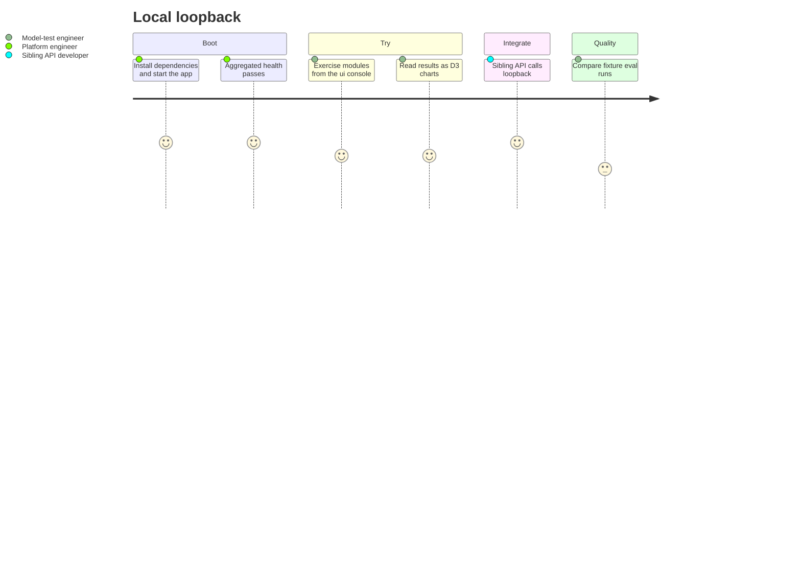

# User Story Map

> Jeff Patton story map + Mermaid journey + GWT epics in files.  
> Index only; details in [user-stories/](./user-stories/).

## Personas

| Role | Description |
| ---- | ----------- |
| Platform engineer | Starts the loopback ML app locally and mounts fixture data |
| Sibling API developer | Calls recommendation / vision / rag / image_playground / speech / video routes on one base URL |
| Model-test engineer | Exercises each module from the `ui/` operator console on :4200 |

## Journey overview

### Local loopback

Health means `GET /health` on port 8000: one entry per loaded module with
`status` (`ok`, `degraded` or `error`) and `latency_ms`.

## Backbone story map

### Done

| Modular services | Unified app | Operator console |
| ---------------- | ----------- | ---------------- |
| [US-01](./user-stories/E1-modular-services.md#us-01-flat-per-module-layout) Flat layout | [US-05](./user-stories/E2-unified-app.md#us-05-single-app-and-aggregated-health) Single app + health | [US-09](./user-stories/E3-operator-console.md#us-09-module-pages) Module pages |
| [US-02](./user-stories/E1-modular-services.md#us-02-rag-export-vectors) RAG export vectors | [US-06](./user-stories/E2-unified-app.md#us-06-secrets-only-in-env) Secrets in `.env` | [US-10](./user-stories/E3-operator-console.md#us-10-d3-charts-on-every-module-page) D3 charts |
| [US-03](./user-stories/E1-modular-services.md#us-03-streaming-asr-over-websocket) Streaming ASR | [US-07](./user-stories/E2-unified-app.md#us-07-vision-scores-and-video-moderation) Vision / video | [US-11](./user-stories/E3-operator-console.md#us-11-embedding-atlas-on-rag) Embedding atlas |
| [US-04](./user-stories/E1-modular-services.md#us-04-fine-tuning-scripts) Fine-tuning scripts | [US-08](./user-stories/E2-unified-app.md#us-08-ui-proxy-and-per-module-health) UI `/ml` proxy | |

### Planned

| Operator console | Contracts and eval |
| ---------------- | ------------------ |
| [US-12](./user-stories/E3-operator-console.md#us-12-eval-dashboard) Eval dashboard | [US-13](./user-stories/E4-contracts-eval.md#us-13-module-io-and-health-contracts-in-glossary) Module I/O & health Glossary |
| | [US-14](./user-stories/E4-contracts-eval.md#us-14-fixture-eval-compare-for-quality-gates) Fixture eval compare |

## Epic index

| Epic | File | Stories | Status |
| ---- | ---- | ------- | ------ |
| E1 Modular services | [E1-modular-services.md](./user-stories/E1-modular-services.md) | US-01 – US-04 | Done |
| E2 Unified app | [E2-unified-app.md](./user-stories/E2-unified-app.md) | US-05 – US-08 | Done |
| E3 Operator console | [E3-operator-console.md](./user-stories/E3-operator-console.md) | US-09 – US-12 | Done (US-12 Planned) |
| E4 Contracts and eval | [E4-contracts-eval.md](./user-stories/E4-contracts-eval.md) | US-13 – US-14 | Planned (builds on US-12) |

## Related

- [User Story Mapping — Jeff Patton](https://www.jpattonassociates.com/user-story-mapping/)
- [Domain Glossary](../Glossary.md)
